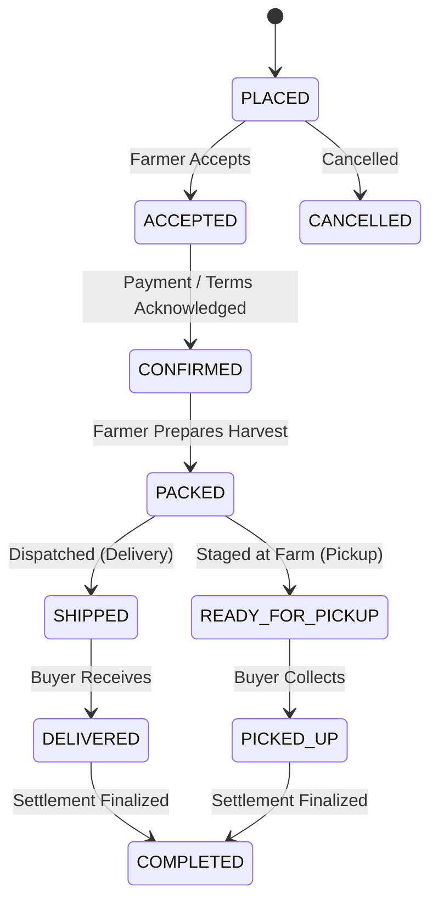

# KisanSetu (किसानसेतू / किसानसेतु)
### Direct Farmer-to-Consumer & Buyer Marketplace Platform

> **Empowering Indian agriculture through direct trade, eliminating middleman exploitation, and providing factual market intelligence.**

---

## 🌾 Project Overview

**KisanSetu** is a full-stack digital marketplace connecting farmers directly with retail consumers, bulk buyers, restaurants, and agribusinesses without middleman commissions. Built in strict alignment with the **KisanSetu Project Specification**, it addresses the critical systemic bottlenecks in the Indian agricultural supply chain:
- **Zero Middleman Commissions:** 100% of the negotiated harvest price flows directly to the farmer, with a configurable platform fee (defaulted to 0.0%).
- **Interactive Price Negotiation:** Buyers propose offers with target quantities and unit rates; farmers can accept, counter-offer, or decline. Accepted offers seamlessly convert into binding orders.
- **Strict Concurrency & Overselling Protection:** High-concurrency orders are secured with atomic database-level stock decrement queries, preventing overselling even during flash harvest sales.
- **Idempotency Guarantee:** Order creation uses unique client idempotency keys, eliminating duplicate charges or duplicate bookings from network retries.
- **Strict Linear Order State Machine:** Progression strictly enforces verified transitions:
  `Placed → Accepted → Confirmed → Packed → Shipped / ReadyForPickup → Delivered / PickedUp → Completed`.
- **Verified APMC Mandi Benchmark Rates:** Strict market intelligence sourced from verified APMC government records. **No AI-invented or hallucinated rates**; AI provides only historical contextual commentary and advisory with clear disclaimers.
- **Verified Buyer Reviews:** Reviews and 1–5 star ratings are cryptographically and logically restricted to verified buyers who have completed an order for that specific crop listing.
- **Trilingual Accessibility:** Complete UI localization supporting **Marathi (मराठी)**, **Hindi (हिंदी)**, and **English**, tailored for rural usability.
- **Offline Draft Engine:** Offline farmer listing drafts are cached locally in browser IndexedDB with visual pending-sync flags, allowing farmers to compose listings in low-connectivity rural zones.

---

## 🛠️ Technology Stack

| Layer | Technologies & Frameworks | Key Highlights |
| :--- | :--- | :--- |
| **Backend** | Java 17, Spring Boot 3.2.5, Spring Data JPA, Hibernate, Maven 3.9+ | RESTful APIs, Bean Validation, Concurrent Locking, Dynamic JPA Repositories |
| **Database** | MySQL 9.4 Server (Port 3306) with In-Memory H2 Fallback | InnoDB Engine, ACID transactions, Foreign Key constraints, DB-level atomic checks |
| **Frontend** | React 18, TypeScript, Vite, Tailwind CSS, Lucide React, Framer Motion | Emerald aesthetic, Dark/Light modes, Responsive grid, Localized context, Persona switcher |
| **Storage & Caching** | Browser IndexedDB (Client offline cache) | Local persistence of drafts with auto-sync capability |
| **Testing** | JUnit 5, Spring Boot Test, MockMvc, Maven Surefire | Automated integration tests for stock concurrency, idempotency, and state machine |

---

## 📂 Project Structure

```text
KIsansetu is here/
├── backend/                               # Spring Boot 3 Application
│   ├── src/main/java/com/kisansetu/
│   │   ├── config/                        # Security & Web MVC configurations
│   │   ├── controller/                    # REST API Controllers (Crop, Order, Offer, Admin, etc.)
│   │   ├── dto/                           # Data Transfer Objects & Validation records
│   │   ├── entity/                        # JPA Entities (CropListing, Order, Offer, User, etc.)
│   │   ├── exception/                     # Global exception handling & error responses
│   │   ├── initializer/                   # Automated demo data & verified APMC rate seeder
│   │   ├── repository/                    # Spring Data Repositories with atomic SQL queries
│   │   └── service/                       # Core domain business logic & state machines
│   ├── src/main/resources/
│   │   ├── application.properties         # Active profile selector & global configs
│   │   ├── application-mysql.properties   # Production MySQL 9.4 database profile
│   │   └── application-h2.properties      # Zero-config standalone in-memory test profile
│   ├── src/test/java/com/kisansetu/       # Comprehensive automated integration test suite
│   └── pom.xml                            # Maven project definition
├── frontend/                              # Vite + React + TypeScript Application
│   ├── src/
│   │   ├── components/                    # UI elements (Header, Sidebar, Modals, Badges)
│   │   ├── context/                       # LanguageContext (EN/MR/HI), AuthContext (Persona switch)
│   │   ├── i18n/                          # Comprehensive English, Marathi, Hindi translations
│   │   ├── routes/                        # Application views (Marketplace, MyListings, Orders, Offers, AdminCenter, etc.)
│   │   ├── services/                      # REST client (marketplaceApi) & Offline IndexedDB engine
│   │   ├── App.tsx                        # Root layout & page router
│   │   └── main.tsx                       # React application entry point
│   ├── package.json                       # Dependencies & scripts
│   ├── tailwind.config.js                 # Design tokens, emerald color palette
│   └── vite.config.ts                     # Vite bundler configuration
├── .env.example                           # Sample environment configuration
├── .gitignore                             # Ignored paths (target/, node_modules/, secrets)
├── audit_and_implementation_plan.md       # Comprehensive architecture & diagnostics audit artifact
└── README.md                              # This master documentation file
```

---

## 🚀 Getting Started & Local Setup

### 1. Prerequisites
- **Java Development Kit (JDK):** Version 17 or higher (`java -version`)
- **Node.js & npm:** Node 18+ and npm 9+ (`node -v`, `npm -v`)
- **Apache Maven:** Maven 3.8+ (or use the embedded IDE maven runner)
- **Database:** MySQL Server 9.4 (Windows service `MySQL94` on port `3306`) OR standalone in-memory fallback.

---

### 2. Backend Setup & Running

#### Option A: Running with Standalone In-Memory Profile (Immediate Zero-Setup Run)
The backend comes pre-configured with a fallback profile that runs out of the box with zero database configuration needed:
```powershell
cd "backend"
# Run with Spring Boot Maven plugin
mvn spring-boot:run -Dspring-boot.run.profiles=h2
```
*The backend starts at `http://localhost:8080`, automatically seeds verified APMC market prices, demo farmers, listings, and sample orders.*

#### Option B: Running with MySQL 9.4 (Production Database)
1. Verify the MySQL 9.4 service is running:
   ```powershell
   Get-Service -Name MySQL94
   ```
2. Create the database schema if not already present:
   ```sql
   CREATE DATABASE IF NOT EXISTS kisansetu CHARACTER SET utf8mb4 COLLATE utf8mb4_unicode_ci;
   ```
3. Configure your MySQL credentials in `backend/src/main/resources/application-mysql.properties`:
   ```properties
   spring.datasource.url=jdbc:mysql://localhost:3306/kisansetu?createDatabaseIfNotExist=true&useSSL=false&allowPublicKeyRetrieval=true&serverTimezone=UTC
   spring.datasource.username=root
   spring.datasource.password=YOUR_MYSQL_ROOT_PASSWORD
   ```
4. Start the backend with the MySQL profile:
   ```powershell
   cd "backend"
   mvn spring-boot:run -Dspring-boot.run.profiles=mysql
   ```

---

### 3. Frontend Setup & Running

1. Navigate to the frontend directory and install dependencies (if not already installed):
   ```powershell
   cd "frontend"
   npm install
   ```
2. Start the Vite development server:
   ```powershell
   npm run dev
   ```
3. Open your browser and navigate to:
   ```
   http://localhost:5173
   ```

---

## 👥 Personas & Demo Accounts (Instant Role Switching)

The header bar provides a **Persona Switcher** allowing you to instantly test every aspect of the role-based workflows:

| Persona | Role | Default User Details | Capabilities |
| :--- | :--- | :--- | :--- |
| **Ramesh Patil** | `FARMER` | Pune, Maharashtra (Organic Certified, ⭐ 4.9) | Create listings, pause/resume stock, manage bids/offers, pack & ship orders, save offline drafts. |
| **Pooja Deshmukh** | `CONSUMER` | Pune, Maharashtra | Browse direct farm harvest, submit price negotiation offers, direct buy, track orders, review completed purchases. |
| **Apex Agri Traders** | `WHOLESALER` | Vashi, Navi Mumbai (GST Verified) | Place bulk orders, propose large-lot price offers, manage logistics. |
| **Platform Moderator** | `ADMIN` | System Administrator | Inspect platform KPIs, adjust platform fee (0% default), upload official APMC CSVs, audit dispute resolution. |

---

## 🔒 Core Engineering Guarantees & Workflows

### 1. Concurrency & Overselling Protection
When buyers place direct orders or accept offers, stock decrement is executed at the database engine level via an atomic conditional SQL operation:
```sql
UPDATE crop_listings 
SET available_quantity = available_quantity - :qty 
WHERE id = :id AND available_quantity >= :qty;
```
If two buyers simultaneously attempt to buy the remaining stock, one transaction succeeds with row count `1`, and the conflicting transaction immediately receives `0` updated rows, triggering a safe `409 Conflict: Insufficient stock available` rollback before order creation.

### 2. Idempotent Order Creation
All order submission requests include an `idempotencyKey` UUID header/payload:
- If a mobile user loses connectivity and taps "Place Order" twice, the backend detects the duplicate idempotency key and returns the already-created order without double-deducting stock or duplicating payments.

### 3. Linear State Machine
Order states strictly advance through validated sequences:

- Direct jumps (e.g., `PLACED → COMPLETED`) are rejected with `400 Bad Request`.
- Cancellation is strictly forbidden once an order is marked `PACKED`, `SHIPPED`, or `DELIVERED`.

### 4. Verified Mandi Intelligence (Zero Hallucination)
- Mandi rates for Onion, Tomato, Soybean, Pomegranate, Wheat, etc. originate exclusively from verified APMC market records seeded from official Maharashtra mandis (Pune APMC, Lasalgaon, Kolhapur, Solapur, Nagpur).
- Farmers viewing listings can click "Check Mandi Rate" to see current min/modal/max benchmark prices to avoid underselling.
- The AI advisory endpoint strictly requires a verified record ID or official APMC rate inputs and attaches an explicit legal disclaimer.

### 5. Verified Reviews Only
- The backend checks whether the reviewer has a `COMPLETED` order for the target `cropListingId`.
- Unverified buyers or users with pending/in-transit orders are rejected with `403 Forbidden`.
- Each order can be reviewed at most once, preventing rating manipulation.

### 6. Offline Drafts via IndexedDB
- Farmers working in fields with intermittent 4G/2G connectivity can compose new harvest listings in the **My Listings** tab and click **Save as Offline Draft**.
- The draft is persisted in the browser's IndexedDB storage with an amber "Draft (Pending Sync)" status badge.
- As soon as connectivity returns, the farmer can tap "Sync to Cloud" to publish the harvest instantly.

---

## 🧪 Testing & Quality Assurance

The backend includes a comprehensive integration test suite verifying all critical business constraints:
```powershell
cd "backend"
mvn test
```

### Verified Test Cases (`KisanSetuApplicationTests.java`):
1. `testAtomicStockDeductionPreventsOverselling()`: Verifies that concurrent or exceeding stock requests are blocked and stock is decremented atomically.
2. `testIdempotencyPreventsDuplicateOrders()`: Submits identical idempotency keys; verifies only one order and one stock decrement occurs.
3. `testOrderLifecycleProgression()`: Validates linear progression (`PLACED → ACCEPTED → CONFIRMED → PACKED → SHIPPED → DELIVERED → COMPLETED`) and rejects illegal skipped transitions.
4. `testOfferAcceptanceCreatesOrder()`: Validates negotiation bid workflow and automatic conversion to an active order.
5. `testReviewOnlyAllowedOnCompletedOrder()`: Validates that unverified buyers cannot submit reviews.
6. `testFactualAiMarketExplainerRequiresPrices()`: Verifies zero hallucination by ensuring market commentary references strictly verified APMC numbers with required disclaimers.

---

## 📄 License & Academic Attribution
Developed as part of the **KisanSetu Project** — direct agricultural marketplace model dedicated to fair trade and economic empowerment for Indian farmers.
# KisanSetu

